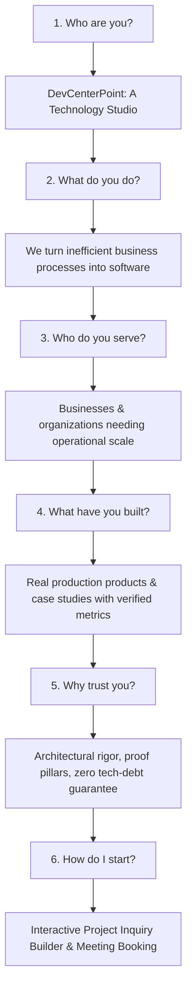

# DevCenterPoint Studio — Strategic Architecture & Implementation Plan

> **Strategic North Star:**
> **"We turn inefficient business processes into software."**  
> *Business Automation · Custom Software · Intelligent Systems*

---

## 1. Brand Positioning & Core Messaging Architecture

### The Problem With Previous Positioning
The previous tagline (*"Technical, Software and Web Development and Support"*) was overly generic, dilute, and described low-margin contractor tasks rather than high-value strategic technology outcomes.

### The New Locked Positioning Hierarchy

| Level | Copy / Definition | Strategic Purpose |
| :--- | :--- | :--- |
| **Primary Positioning** | **"We turn inefficient business processes into software."** | Crystal-clear value proposition. Tells executive decision-makers immediately what ROI to expect. |
| **Supporting Descriptor** | **Business Automation · Custom Software · Intelligent Systems** | Defines the three core pillars without confusing breadth. |
| **Expanded Company Profile** | **"DevCenterPoint is a technology company building custom software, business automation systems, SaaS products, e-commerce platforms, and intelligent digital solutions for businesses and organizations."** | Reassures clients we have the technical chops to build complex ERPs, clinics, e-commerce, and AI without sounding like a generic do-everything shop. |
| **Tone & Aesthetic** | **Premium modern engineering studio** | High-trust, elite craft, dark/light glassmorphic sophistication, zero marketing fluff, technical precision. |

---

## 2. Information Architecture (IA)

### Scalable Site Hierarchy
```
/
├── Home                              (Answers the 6 core business questions in 10 seconds)
├── Solutions                         (The 8 core business capabilities)
│   ├── /solutions/custom-software
│   ├── /solutions/business-automation
│   ├── /solutions/ecommerce
│   ├── /solutions/saas
│   ├── /solutions/intelligent-systems
│   └── /solutions/support
├── Products                          (In-house IP & turn-key platforms: ERP, Clinic Queue OS)
├── Work                              (Curated Case Studies & Verified Client Deployments)
├── About                             (Engineering Philosophy, Founder Craft, Standards)
├── Insights                          (Deep-dive engineering case notes & architecture guides)
└── Contact                           (Project Scope Estimator & Consultation Booking)
```

---

## 3. The 6-Question Homepage Framework

Every prospective client scrolling the homepage must get rapid, unambiguous answers:



### Homepage Section Mapping

1. **Hero & Telemetry:**
   - Pre-badge: `TECHNOLOGY COMPANY • BUSINESS AUTOMATION & AI`
   - Headline: **"We turn inefficient business processes into software."**
   - Subhead: Supporting descriptor + expanded description.
   - Proof Badges: `• Status: Operational` | `99.9% Reliability` | `Ultra-Fast Speed`
   - Dual CTAs: `Start a Project` & `Book a Consultation` (Cal.com integration).

2. **The 8-Category Solution Studio:**
   Instead of overwhelming users with 15 unorganized bullet points, the homepage displays 8 structured capability cards:
   - `01` **Custom Software** — Internal tools, portals, bespoke systems.
   - `02` **Business Automation** — Workflow triggers, data sync, manual effort reduction.
   - `03` **E-commerce Systems** — High-concurrency storefronts, inventory sync, omnichannel checkout.
   - `04` **SaaS Products** — Multi-tenant architectures, subscription billing, RBAC.
   - `05` **AI & Intelligent Systems** — Applied ML, predictive pipelines, RAG & LLM agents.
   - `06` **Web & Mobile Applications** — High-density, reactive cross-platform interfaces.
   - `07` **UI/UX & Digital Experience** — High-contrast design systems built for operator efficiency.
   - `08` **Technology Support** — SLA-backed maintenance, performance tuning, cloud migrations.

3. **Curated Work & Case Studies (4-Tier Taxonomy):**
   - **Tier A: Company Case Studies** (Client contracts delivered under DevCenterPoint)
   - **Tier B: Founder Portfolio** (High-craft projects by founder establishing technical depth)
   - **Tier C: Products** (Commercial systems e.g., DevCenterPoint ERP, Feroza Clinic Queue OS, RoadSafety OS)
   - **Tier D: Experiments / Labs** (Sandbox interactive demos)

4. **Evidence & Architecture (Why Trust Us):**
   - 5-layer engineering philosophy (Discovery → Clean Core → High-Density UI → Automated Data → Scale).
   - Verifiable metrics (e.g. "65% queue reduction", "100% double-allocation elimination").

5. **Inquiry Builder & Conversion Engine:**
   - Multi-step interactive scope estimator (Project Type, Timeline, Budget, Tech Stack).
   - Direct database storage in Laravel + Firebase backup + Admin CRM alerts.

---

## 4. Phased Implementation Roadmap

### Phase 1: Positioning & Hero Alignment (Immediate)
- [x] Replaced jargon telemetry badges (`• Status: Operational`, `99.9% Reliability`, `Ultra-Fast Speed`).
- [ ] Update [Hero.tsx](file:///d:/DevCenterPoint-Studio/backend/resources/js/Components/Hero.tsx) headline, badge, and thesis statement with the locked positioning.
- [ ] Update [Positioning.tsx](file:///d:/DevCenterPoint-Studio/backend/resources/js/Components/Positioning.tsx) copy to reinforce *"We turn inefficient business processes into software"*.
- [ ] Update database seeders and live `site_settings` in SQLite.

### Phase 2: Refactor Capabilities & Service Architecture (Next)
- [ ] Consolidate capabilities into the standardized 8-bucket structure (`01` through `08`).
- [ ] Update [capabilities.ts](file:///d:/DevCenterPoint-Studio/backend/resources/js/data/capabilities.ts) and database seeder [DatabaseSeeder.php](file:///d:/DevCenterPoint-Studio/backend/database/seeders/DatabaseSeeder.php) with clear problem-to-solution outputs for each bucket.
- [ ] Align the `/services` index and detail routes with these 8 canonical slugs.

### Phase 3: Portfolio Taxonomy & Case Studies (Work)
- [ ] Add category tags/badges to projects in [SelectedWorkSection.tsx](file:///d:/DevCenterPoint-Studio/backend/resources/js/Components/SelectedWorkSection.tsx):
  - `Company Delivery`
  - `Commercial Product`
  - `Founder Foundation`
- [ ] Update project cards to lead with **Business Inefficiency Solved** + **Measurable Outcome**.

### Phase 4: Conversion & Inquiry Builder Polish
- [ ] Align project types in [ProjectInquiryBuilder.tsx](file:///d:/DevCenterPoint-Studio/backend/resources/js/Components/ProjectInquiryBuilder.tsx) to match the 8 service categories.
- [ ] Ensure instant confirmation email/screen with reference number and calendar booking prompt.

### Phase 5: Admin CMS & Settings Parity
- [ ] Update [Admin Settings Index.tsx](file:///d:/DevCenterPoint-Studio/backend/resources/js/Pages/Admin/Settings/Index.tsx) with fields and presets for the new positioning statements.
- [ ] Verify that admin edits reflect immediately across all public views via Inertia props.
